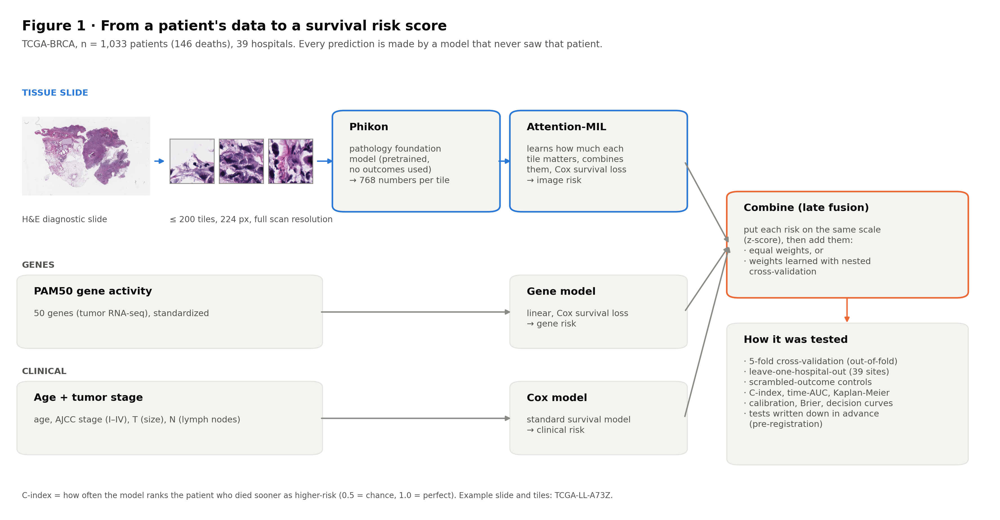
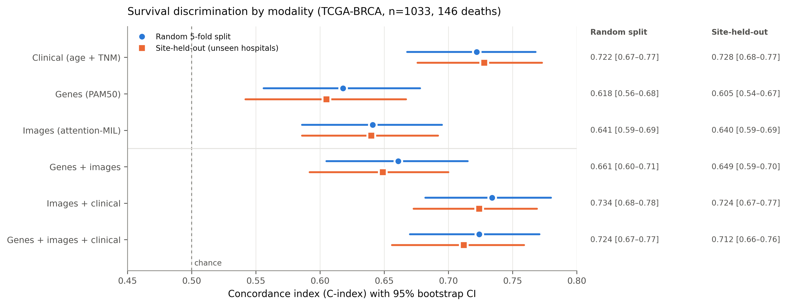
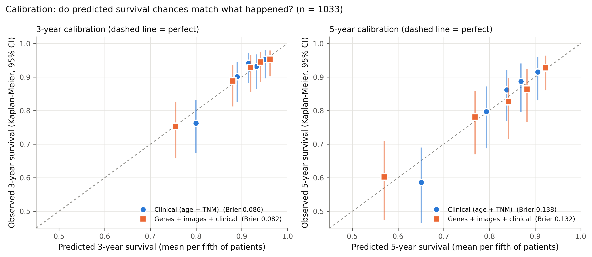
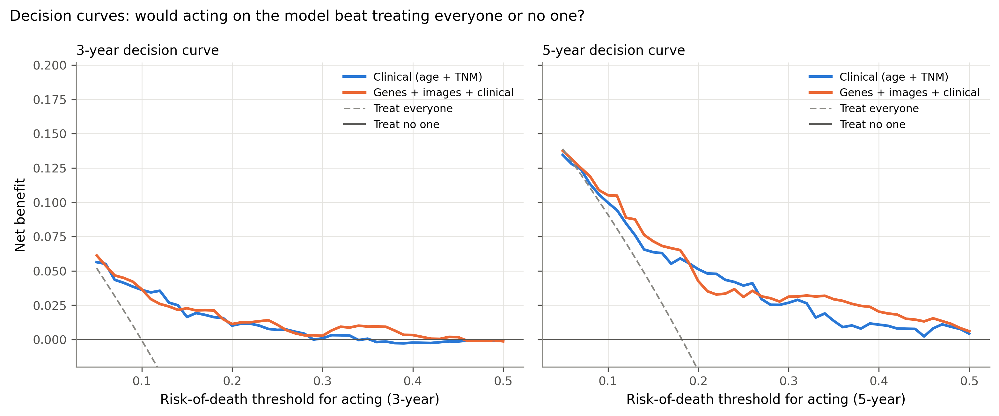
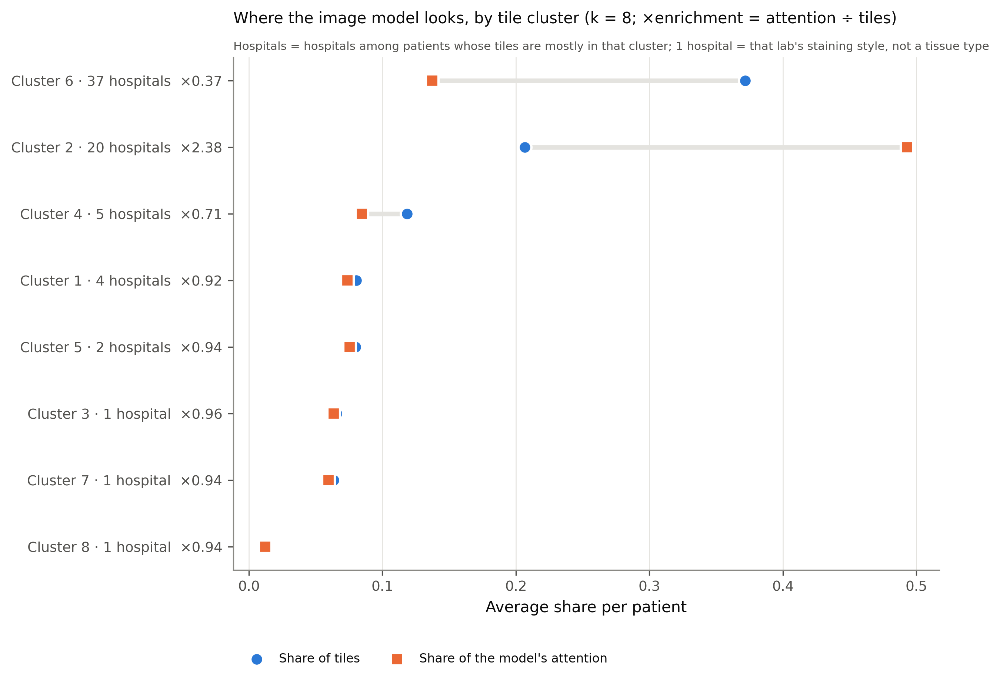
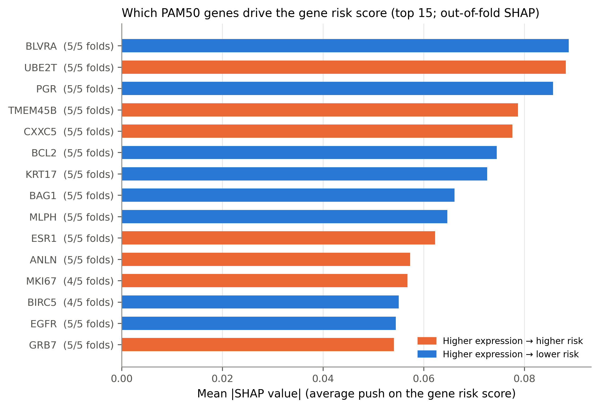
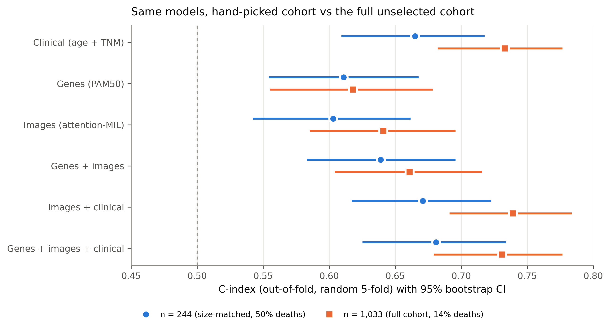

# 🧬🔬 Multi-Modal Breast-Cancer Prognosis

### Does combining a tumor's **genes**, its **microscope slide**, and **clinical staging** predict survival better than staging alone?


> A reproducible study of breast-cancer survival that combines tumor **gene expression**, **whole-slide histopathology**, and **clinical staging**, on **every eligible TCGA-BRCA patient (n = 1,033, 146 deaths, 39 hospitals)**, with pre-registered analyses, leakage controls, unseen-hospital validation, and honest reporting of what did and did not hold up.
>
> **Researcher:** Shiv Prahalathan · 2026
> **Status:** full-cohort analysis complete · pre-registered follow-ups (Amendments A–C) complete · manuscript in preparation

---

## 📌 TL;DR

- **The slide AI finds real, hospital-robust survival signal.** Out-of-fold C-index **0.641** for images alone, and **0.640 on hospitals it never trained on** (39 hospitals).
- **That signal is independent of staging** (pre-registered primary test): in a Cox model with age, stage, T and N, the image risk has **HR 1.40 per SD [1.20, 1.62], p = 2.5 × 10⁻⁵**. It is almost uncorrelated with stage (ρ = 0.02) and survives adjustment for tissue composition (HR 1.29), slide file size (HR 1.38), halving the tiles (HR 1.41), and removing non-tissue tiles (HR 1.37).
- **But it barely improves ranking beyond staging.** Clinical staging alone reaches **0.722**; the best combination (learned weights, nested CV) reaches **0.738** (+0.017, 95% CI [−0.011, +0.045], p = 0.21). The data rule out gains larger than about +0.045.
- **A promising early result did not replicate.** On a hand-picked 244-patient sample (50% deaths) the gain looked like +0.034; on all 1,033 patients it was +0.003. Both are reported.

C-index = how often the model ranks the patient who died sooner as higher-risk (0.5 = chance, 1.0 = perfect). HR = hazard ratio (how many times higher the death rate is per step up in the score).



## ✨ Highlights

- 🏥 **Unseen hospitals** — leave-one-hospital-out testing across 39 sites: images 0.640, full model 0.712.
- 🧾 **Pre-registered** — the analysis plan (June) and three amendments (Oct 2–4) were written *before* the analyses they cover ([`PREREGISTRATION.md`](PREREGISTRATION.md) §11–14).
- 🔬 **Caught a fake signal** — a naive image model scored 0.907 because slide file size tracked outcome; it was rejected, and file size is checked in every later analysis.
- 🛡️ **Leakage controls** — scrambled outcomes give 0.496 (10 shuffles); five seeds give 0.715 ± 0.006; retrained models reproduce cached predictions to ~1e-15.
- 🎯 **Well calibrated** — predicted 3- and 5-year survival falls inside the observed 95% CI in all 20 quintile groups; Brier 0.132 vs 0.138 (clinical) at 5 years.
- 🧠 **Where the AI looks** — half its attention goes to stroma-rich tissue (21% of tiles); tissue composition alone barely predicts survival (C 0.532).
- 🔁 **Cross-cohort gene validation** — trained on METABRIC (microarray), tested on TCGA (RNA-seq): 0.652.
- 📦 **Verifiable** — pinned environment, a 1,033-patient manifest with GDC slide MD5s and feature SHA-256s, and checksums for every result file ([`reproducibility/`](reproducibility/)).

## ❓ The Question

> Can machine learning predict breast-cancer survival from gene expression and histopathology, does it generalize beyond its training data, and does it add anything beyond the clinical staging doctors already use?

## 📊 Data (100% public)

| Dataset | Modality | Size | Role |
|---|---|---|---|
| **TCGA-BRCA** | diagnostic whole-slide images (GDC) + RNA-seq (PAM50) + clinical + survival | **1,033 patients, 146 deaths, 39 hospitals** | Main study |
| **METABRIC** | gene expression (microarray) + clinical + survival | 1,980 patients | Gene model development; external validation |
| **BreakHis** | histopathology images | ~9,000 images | Image-pipeline check |

How 1,082 TCGA-BRCA patients became the 1,033 analysed: [Figure S1](results/figures/figS1_cohort_flow.png). Provenance and citations: [`docs/DATA_SOURCES.md`](docs/DATA_SOURCES.md).

## ⚙️ Methods

- **Slides → tiles → features:** up to 200 tissue tiles per diagnostic slide (224 px, ~20×) → **Phikon** pathology foundation model (768 numbers per tile; pretrained without outcomes). Slides are verified against GDC's MD5 and deleted after feature extraction.
- **Models:** gated **attention-MIL** with a Cox loss (images); linear Cox-loss model (50 PAM50 genes); Cox model (age, AJCC stage, T, N).
- **Fusion:** late fusion of z-scored risks — equal weights, and weights learned with **nested cross-validation**.
- **Validation:** 5-fold out-of-fold predictions · leave-one-hospital-out · METABRIC → TCGA (genes) · models trained on the original 244 tested on the 789 new patients.
- **Statistics:** bootstrap 95% CIs; paired-bootstrap ΔC; Cox likelihood-ratio tests; time-dependent AUC; Kaplan-Meier + log-rank; calibration and Brier at 3 and 5 years; decision curves; Holm correction for subgroups.
- **Shortcut checks:** slide-size confound; tissue composition from k-means clustering of all 206,488 tiles; cluster examples verified against the saved features; fat sub-cluster test.
- All settings: [Table S1](results/supplement/table_s1_settings.md). Every script: [`docs/SCRIPTS.md`](docs/SCRIPTS.md). Every step, dated: [`LAB_NOTEBOOK.md`](LAB_NOTEBOOK.md) (Entries 1–16).

## 📈 Results — full cohort (n = 1,033, 146 deaths, 39 hospitals)



| Model | Random 5-fold | Unseen hospitals |
|---|---|---|
| Clinical (age + TNM) | 0.722 [0.67–0.77] | 0.728 [0.68–0.77] |
| Genes (PAM50) | 0.618 [0.56–0.68] | 0.605 [0.54–0.67] |
| Images (Phikon + attention-MIL) | 0.641 [0.59–0.69] | 0.640 [0.59–0.69] |
| Genes + images | 0.661 [0.60–0.71] | 0.649 [0.59–0.70] |
| Images + clinical | 0.734 [0.68–0.78] | 0.724 [0.67–0.77] |
| Genes + images + clinical (equal weights) | 0.724 [0.67–0.77] | 0.712 [0.66–0.76] |
| **Genes + images + clinical (learned weights, nested CV)** | **0.738 [0.69–0.78]** | — |

**Does the image score add information beyond staging?** (Cox likelihood-ratio tests; HR per 1 SD of image risk)

| Model | HR [95% CI] | p |
|---|---|---|
| age + stage + T + N **+ image** (pre-registered primary) | **1.40 [1.20, 1.62]** | **2.5 × 10⁻⁵** |
| … image risk from leave-one-hospital-out models | 1.28 [1.08, 1.51] | 0.005 |
| … also adjusted for slide file size | 1.38 | 4.4 × 10⁻⁵ |
| … also adjusted for tissue composition (k = 8 / k = 12) | 1.29 / 1.28 | 0.002 / 0.004 |
| … image model trained on 100 tiles per patient | 1.41 [1.21, 1.64] | 2.0 × 10⁻⁵ |
| … image model re-trained without non-tissue tiles (Amendment C) | 1.37 [1.18, 1.59] | 5.5 × 10⁻⁵ |

All sensitivity analyses: [Table S2](results/supplement/table_s2_sensitivity.md).

| Calibration (3 and 5 years) | Decision curves |
|---|---|
|  |  |

| Where the image model looks | Which genes drive the gene score |
|---|---|
|  |  |

### What changed between the hand-picked 244 and all 1,033 patients



The original 244 patients were a size-matched case/control sample with 50% deaths. In the full, unselected cohort (14% deaths) staging is much stronger (0.632 → 0.722), the image model is slightly stronger (0.603 → 0.641), and the fusion gain over staging shrinks from +0.034 to +0.003. The 244-patient results remain in [`results/`](results/) and Lab Notebook Entries 9–12.

**Earlier stages:** METABRIC → TCGA gene validation 0.652; the full ~20,000-gene transcriptome did no better than PAM50 (~0.60); BreakHis benign-vs-malignant classifier AUC 0.84.

## ⚠️ Limitations

- **One data source.** No public breast cohort has slides, genes and survival together (CPTAC-BRCA lacks follow-up), so leave-one-hospital-out testing is quasi-external.
- **146 deaths, 32-month median follow-up.** Small gains over staging cannot be confirmed; endpoint is death from any cause.
- **Phikon was pretrained on TCGA images** (without outcomes) — no label leakage, but an independent cohort would remove any familiarity advantage.
- **Image shortcuts:** composition, slide size, non-tissue and hospital-style checks pass, but tile-cluster labels are a non-expert read pending pathologist review. The tissue filter admits a small share (0.9%) of non-tissue tiles (dark background, red ink), and fat could not be isolated as its own tile group, so a fat-specific effect inside stroma-rich tissue is not ruled out.
- **Subgroups are exploratory**; decision curves are descriptive.
- For 7 original-cohort patients with 2 diagnostic slides, the exact slide used cannot be recovered (listed in the manifest).
- Observational data → **associations, not causation**. A research model, **not a clinical tool**.

## 🤖 AI assistance

Code in this repository was written with the help of an AI coding assistant (Claude). The research questions, analysis decisions, pre-registration, and interpretation are the author's; every result is reproducible from the scripts and verified by the checksums in [`reproducibility/`](reproducibility/).

## 🗂️ Repository Structure

```
├── README.md · LAB_NOTEBOOK.md · PREREGISTRATION.md · PUBLICATION_ROADMAP.md
├── config.py                  # studies, gene panel, seed
├── reproducibility/           # pinned packages, environment, 1,033-patient manifest, result checksums
├── src/
│   ├── fetch_data.py · eda.py                          # public data + survival-by-subtype
│   ├── model.py · validate_external.py · boost_genes.py # gene survival, METABRIC→TCGA, transcriptome
│   ├── stage_c_local.py · stage_c_parallel.py · stage_c_pathology.py   # slides → Phikon tile features
│   ├── stage_cd.py · stage_e_attmil.py                 # confound gate, attention-MIL survival
│   ├── stage_f_redundancy.py · stage_g_latefusion.py   # complementarity, late fusion
│   ├── stage_h_clinical.py · stage_i_leavesite.py      # clinical baseline, unseen hospitals
│   ├── stage_j_metrics.py · make_figures.py            # robustness, metrics, figures (n = 244)
│   ├── stage_k_heatmaps.py                             # attention heatmaps
│   ├── stage_l_fullcohort.py                           # every analysis on n = 1,033 + calibration
│   ├── stage_m_added_value.py                          # Amendment A: beyond staging
│   ├── stage_n_tissue.py                               # Amendment B: tissue composition
│   ├── stage_o_followups.py                            # Amendment C: fat, robustness, gene SHAP
│   ├── make_paper_figures.py · make_manifest.py        # Fig 1, supplement, reproducibility package
│   └── watch_download.py                               # live progress screen for the slide download
├── notebooks/                 # Colab notebooks (BreakHis classifier, slide pipeline)
├── docs/                      # script docs, data sources, Colab guides; archive/ = superseded July write-up
└── results/                   # n = 244 results, fullcohort/ (n = 1,033), supplement/, figures/
```

## ▶️ Reproduce It

```bash
git clone https://github.com/Aeronite-P/breast-cancer-prognosis.git
cd breast-cancer-prognosis
python3 -m venv .venv && source .venv/bin/activate
pip install -r reproducibility/requirements-lock.txt      # exact versions used

python src/fetch_data.py                   # public gene + clinical data (cBioPortal)
python src/stage_c_pathology.py --all      # every TCGA-BRCA slide → Phikon features (~800 GB downloaded, ~240 MB kept; resumable, MD5-verified)
python src/stage_l_fullcohort.py           # all models, unseen hospitals, controls, calibration (n = 1,033)
python src/stage_m_added_value.py          # Amendment A
python src/stage_n_tissue.py               # Amendment B
python src/stage_o_followups.py            # Amendment C (robustness, gene SHAP)
python src/make_paper_figures.py           # Figure 1 + supplement

shasum -a 256 -c reproducibility/results_checksums.sha256   # every result file should say OK
```

## 🗺️ Roadmap

- [x] Gene survival model + cross-cohort validation · image classifier · imaging survival (confound caught)
- [x] Fusion, clinical baseline, unseen-hospital validation, robustness, heatmaps (n = 244)
- [x] Full 1,033-patient cohort · calibration · decision curves
- [x] Pre-registered follow-ups: beyond staging (A), tissue composition (B), fat / robustness / genes (C)
- [ ] Pathologist review of attention heatmaps and tissue clusters · manuscript — see [`PUBLICATION_ROADMAP.md`](PUBLICATION_ROADMAP.md)

## 📚 Citation & Data

Please cite the source studies — METABRIC (Curtis et al. 2012; Pereira et al. 2016), TCGA-BRCA, BreakHis (Spanhol et al. 2016) — along with cBioPortal (Cerami et al. 2012; Gao et al. 2013), Phikon (Filiot et al. 2023), and attention-based MIL (Ilse et al. 2018). See [`docs/DATA_SOURCES.md`](docs/DATA_SOURCES.md).

## 📄 License

MIT — see [`LICENSE`](LICENSE).
